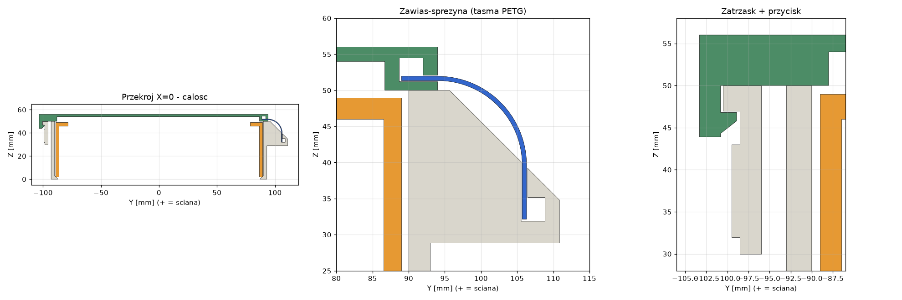

# Uchwyt worka na śmieci z klapką (pod blat)

Ramka przykręcana od spodu do blatu, wciskany pierścień mocujący worek,
klapka otwierana sama po wciśnięciu przycisku od strony pokoju.

## Części

| Plik | Co to | Materiał | Orientacja druku (STL już tak ustawione) |
|---|---|---|---|
| `stl/Ramka.stl` | ramka + płyta montażowa + zatrzask z przyciskiem | PETG (zalecane) | górą do stołu, bez podpór |
| `stl/Klapka.stl` | klapka z haczykiem i kanałem na taśmę | PETG / PLA | górą do stołu, bez podpór |
| `stl/Pierscien.stl` | pierścień na worek | PLA / PETG | górą do stołu (uchwyty na stole) |
| `stl/Tasma.stl` | taśma-sprężyna = zawias | **tylko PETG** | na płasko, listwy do góry |

Wymiary: otwór 170 × 180 mm, wysokość ramki 50 mm, płyta 80 × 120 mm pod blat.
Największa część (ramka z płytą) ma 256 × 211 mm, więc mieści się na stole 300 × 300.

## Jak to działa

* **Worek**: przekładasz brzeg worka przez pierścień (od środka na zewnątrz) i wciskasz
  pierścień od góry w ramkę. Worek zaciska się w 1 mm szczelinie na obwodzie. Pierścień
  opiera się na wewnętrznym kołnierzu 45° na dole ramki, więc nie przeleci na dół.
  Dwa uchwyty na górze pierścienia ułatwiają jego wyjęcie.
* **Zawias i sprężyna w jednym**: to cienka taśma PETG (0,6 mm) z listwami na końcach.
  Listwy wsuwa się bokiem w kanały w ramce i w klapce. Taśma jest drukowana prosto, więc
  przy zamkniętej klapce jest zgięta o 90° (R = 12 mm) i cały czas pcha klapkę do otwarcia
  (ok. 240 N·mm, a ciężar klapki to ok. 95 N·mm). Nie ma metalowych sprężyn ani pinów.
* **Zatrzask**: przed przednią ścianką jest sprężyste ramię z zaczepem, a haczyk klapki
  zaskakuje pod zaczep. Wciśnięcie ramienia (wypukła podkładka od strony pokoju) w stronę
  ściany zwalnia haczyk i klapka odskakuje. Zamykasz ją, dociskając od góry.

## Druk (Bambu Studio)

* Ramka i klapka: PETG, 0,2 mm, 3 obrysy, 15% gyroid. Podpory nie są potrzebne
  (skosy mają 45°, kanały to krótkie mostki).
* **Taśma**: PETG, wysokość warstwy 0,2 mm (daje 3 warstwy), 100% wypełnienia. Ustaw
  wzór powierzchni dolnej i górnej jako linie biegnące **wzdłuż** taśmy (w poprzek listew).
  Jeśli klapka otwiera się za słabo, zwiększ `ts` do 0,8. Jeśli za mocno, zmniejsz do 0,5
  albo zmniejsz `Ws`. Taśma to część eksploatacyjna, bo PETG z czasem się odkształca pod
  stałym obciążeniem. Wydrukuj od razu 2–3 sztuki.
* Pierścień: PLA wystarczy.

## Montaż

Złóż całość **przed** przykręceniem pod blat, bo kanał taśmy w ramce otwiera się od
strony blatu (+X).

1. Wsuń jedną listwę taśmy w kanał klapki od lewej strony (od fartucha bocznego) aż do oporu.
2. Trzymając klapkę pionowo, wsuń drugą listwę w kanał tylnej belki ramki od strony płyty
   montażowej, aż do oporu. Oba kanały są zamknięte z przeciwnych stron, więc taśma i klapka
   nie mogą się przesuwać na boki.
3. Przyłóż płytę do spodu blatu tak, żeby górna krawędź ramki była na poziomie spodu blatu,
   a między bokiem ramki i krawędzią blatu zostało kilka mm luzu. Przykręć 2 wkrętami
   4 mm z łbem stożkowym (długość = grubość płyty 6 mm + ok. 20 mm, tak żeby wkręt nie przebił blatu).
   Zawias jest od strony ściany, a przycisk od strony pokoju.

## Sprawdzenie przed drukiem (zalecana kolejność)

Pełny komplet to ok. 400 cm³ bryły, więc najpierw warto wydrukować małe testy
(`stl/testy/`, łącznie ok. 90 cm³, kilka godzin druku):

| Test | Pliki | Co sprawdza |
|---|---|---|
| **0. Szablon 1:1** | `szablon/szablon_1do1.pdf` (2× A4 poziomo, drukuj w skali 100%, sprawdź linijką odcinek 100 mm) | Przyłóż go pod blat: czy ramka mieści się w szczelinie przy kaloryferze, czy płyta 80 mm mieści się pod nawisem blatu (nie trafia w bok szafki), gdzie wypadną wkręty. Nie zużywa filamentu. |
| **1. Zawias-sprężyna** | `T1_zawias_ramka`, `T1_zawias_klapka`, `T1_tasma_40mm` | Czy listwy taśmy wchodzą w kanały (luz `c`), czy taśma nie pęka przy zginaniu i czy wyraźnie odpycha klapkę. Siła w pełnym modelu będzie 2× większa (taśma 80 mm). |
| **2. Zatrzask** | `T2_zatrzask_ramka`, `T2_zatrzask_klapka` | Czy haczyk zaskakuje, czy przycisk zwalnia go lekkim naciskiem, czy ramię nie pęka. |
| **3. Worek** | `T3_worek_ramka_12mm`, `T3_worek_pierscien_12mm` | Test na prawdziwym worku 65–120 l: czy pierścień z workiem wchodzi w ramkę z rozsądną siłą i trzyma worek. Jeśli wchodzi za ciasno, zwiększ `cb`, a jeśli za luźno, zmniejsz. |

Po każdym teście zmień parametr w `tbh_design.py`, uruchom `python build_cadquery.py`
i `python testy.py` (albo skrypt w Fusion) i drukuj dalej.

W Fusion 360 możesz dodatkowo użyć:
* **Inspect → Interference**: zaznacz wszystkie komponenty. Nie powinno być kolizji.
* **Inspect → Section Analysis**: przekrój płaszczyzną YZ przez środek pokazuje zawias i zatrzask.
* Bambu Studio przed drukiem pokazuje zużycie filamentu i czas druku.

## Pliki CAD

* `fusion360/UchwytWorka/`: **skrypt Fusion 360**. W Fusion otwórz Utilities → Scripts and
  Add-Ins, kliknij „+” i wskaż ten folder, a potem Run. Skrypt tworzy nowy dokument
  z 4 komponentami i pełną historią (szkic → wyciągnięcie/wycięcie/loft, każda operacja
  nazwana po polsku). Wymiary są w `tbh_design.py` (słownik `P`, z komentarzami). Zmieniasz
  je i uruchamiasz skrypt ponownie. Drobne poprawki możesz też robić bezpośrednio
  w wygenerowanym modelu.
* `step/`: STEP każdej części i całego złożenia. Można je zaimportować do Fusion bez skryptu.
* `build_cadquery.py`: generuje STL i STEP z tej samej definicji (`pip install cadquery`).
  `render.py` i `section.py` robią podglądy w `img/`.

Najważniejsze parametry w `P`: `H`, `Wi`, `Di` (rozmiar ramki), `Lp`, `Dp` (płyta), `cb`
(luz na worek; zwiększ, jeśli pierścień wchodzi za ciasno z grubym workiem), `ts`, `Ws`, `R`
(siła sprężyny), `lp` (głębokość zaczepu), `g` (skok przycisku).

## Status weryfikacji

* STL i STEP zbudowane w CadQuery: wszystkie bryły są poprawne, a między ramką, klapką
  i pierścieniem w pozycji zamkniętej nie ma kolizji.
* Skrypt Fusion 360 został sprawdzony tylko na atrapie API (wywołania i kolejność operacji).
  Pierwsze uruchomienie w Fusion zgłosiło błąd (nie można zmienić nazwy komponentu głównego), już poprawiony.
* Nic nie zostało jeszcze wydrukowane. Siła sprężyny i luzy są policzone, ale warto
  zacząć od taśmy i fragmentu zatrzasku.
